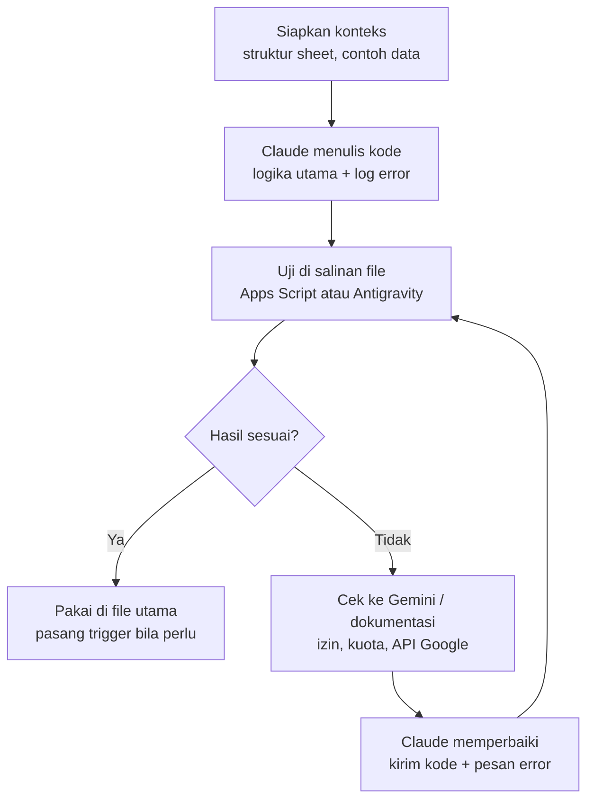

# ai-sales-kpi-automation
# Otomasi Google Apps Script dengan Alur Kerja Claude + Gemini

Studi kasus tentang cara mempercepat otomasi pekerjaan di Google Sheets dengan memadukan dua asisten AI: **Claude** untuk menulis dan memperbaiki kode, **Gemini** untuk memverifikasi hal yang spesifik ke ekosistem Google.

---

## 1. Penjelasan bisnis

### Masalah
Tim analitik penjualan dan distribusi sering mengerjakan hal berulang secara manual: menggabungkan data dari beberapa sheet, membersihkan data, menyusun rekap mingguan atau bulanan, lalu menyiapkannya untuk dashboard. Pekerjaan ini:
- memakan waktu analis yang seharusnya dipakai untuk analisis,
- rawan salah ketik dan salah salin,
- sulit dilacak ketika angka berbeda antar laporan.

### Solusi
Mengotomasi pekerjaan tersebut dengan Google Apps Script. Karena menulis skrip dari nol lambat dan butuh keahlian pemrograman, pembuatan skrip dibantu dua model AI dengan pembagian peran yang jelas (lihat bagian 3).

### Nilai bisnis
| Aspek | Sebelum | Sesudah |
|---|---|---|
| Waktu pembuatan laporan | Manual, berulang | Otomatis lewat trigger |
| Risiko salah data | Tinggi (salin-tempel) | Lebih rendah (aturan tetap di kode) |
| Waktu membuat skrip baru | Lama, tergantung keahlian coding | Lebih singkat dengan bantuan AI |
| Ketertelusuran | Sulit | Ada log dan penanganan error |

### Cara mengukur keberhasilan
Isi dengan angka nyata dari pekerjaan Anda:
- Jam kerja manual per minggu sebelum dan sesudah otomasi: `[X jam] -> [Y jam]`
- Jumlah koreksi data per bulan: `[X] -> [Y]`
- Waktu dari ide sampai skrip berjalan: `[X hari] -> [Y jam]`

### Risiko dan pengendalian
| Risiko | Pengendalian |
|---|---|
| Kode AI salah dan merusak data | Selalu uji di salinan file dulu |
| Data sensitif bocor ke alat AI | Tempel contoh data yang sudah disamarkan |
| Izin akses terlalu luas | Cek scope OAuth dan batasi seperlunya |
| Dua versi kode saling bertabrakan | Satu versi acuan, perbaikan diterapkan ke versi itu |

---

## 2. Alur kerja



## 3. Pembagian peran

| Tahap | Alat | Tugas |
|---|---|---|
| Menulis kode | Claude | Logika utama, pengolahan data, penanganan error, log |
| Debugging | Claude | Menjelaskan penyebab error dan memperbaikinya |
| Verifikasi ekosistem Google | Gemini / dokumentasi resmi | Izin (OAuth), kuota, perubahan API |
| Pengujian | Apps Script / Antigravity | Menjalankan di salinan file |

---

## 4. Langkah-langkah lengkap

### Langkah 1: Tentukan tujuan otomasi
Tulis satu kalimat: apa yang ingin diotomasi, siapa pemakainya, dan kapan dijalankan.
Contoh: "Merekap data penjualan harian per cluster ke satu tab ringkasan setiap pagi."

### Langkah 2: Siapkan konteks
Kumpulkan:
- nama tab dan nama kolom,
- 3-5 baris contoh data (samarkan data sensitif),
- hasil akhir yang diinginkan,
- cara menjalankan: manual, trigger waktu, atau saat ada edit.

### Langkah 3: Minta Claude menulis kode
Gunakan template prompt di bagian 5. Minta kode disertai `try/catch` dan `Logger.log`.

### Langkah 4: Buat salinan file dan pasang kode
1. Di Google Sheets, pilih **File > Buat salinan**.
2. Di salinan, buka **Ekstensi > Apps Script**.
3. Tempel kode, simpan, lalu beri nama proyek.

### Langkah 5: Jalankan dan setujui izin
1. Pilih fungsi utama, klik **Jalankan**.
2. Setujui izin yang diminta. Baca scope-nya dan pastikan wajar.

### Langkah 6: Periksa hasil dan log
Cek hasil di sheet, lalu buka **Eksekusi** atau **Log** untuk melihat pesan dan error.

### Langkah 7: Perbaiki jika ada masalah
1. Salin pesan error lengkap beserta bagian kode yang bermasalah.
2. Jika terkait izin, kuota, atau API Google, cek ke Gemini atau dokumentasi resmi.
3. Kirim temuan ke Claude untuk diperbaiki, lalu ulangi Langkah 5 dan 6.

### Langkah 8: Pasang di file utama dan jadwalkan
1. Salin kode yang sudah lolos uji ke proyek Apps Script file utama.
2. Atur trigger lewat ikon jam di sidebar Apps Script.
3. Catat versi kode dan tanggal perubahan.

---

## 5. Template prompt

```text
Saya punya Google Sheets dengan tab "[NAMA TAB]".
Kolom: [KOLOM A], [KOLOM B], [KOLOM C].
Contoh data:
[TEMPEL 3-5 BARIS]

Tujuan: [APA YANG INGIN DIOTOMASI].
Dijalankan: [manual / trigger waktu / saat edit].
Buatkan Google Apps Script dengan penanganan error dan log.
```

## 6. Prinsip kerja

1. **Satu sumber kebenaran.** Hanya satu versi kode yang jadi acuan.
2. **Konteks lengkap di awal.** Hasil AI mengikuti kualitas informasi yang diberikan.
3. **Uji di salinan.** Jangan langsung di file produksi.
4. **Error dikirim utuh.** Pesan lengkap membuat diagnosis lebih akurat.
5. **Log sejak awal.** Mempermudah pelacakan.

## 7. Struktur repositori

```text
.
├── README.md
├── contoh/
│   ├── nama-skrip.gs
│   └── catatan.md
└── prompt/
    └── template.md
```

## 8. Catatan

Kemampuan model AI terus berubah. Pembagian peran di atas adalah panduan praktis, bukan aturan kaku.

## Kontak

- GitHub: [@USERNAME-ANDA](https://github.com/USERNAME-ANDA)
- LinkedIn: [isi tautan Anda]
- Email: [isi email Anda]
